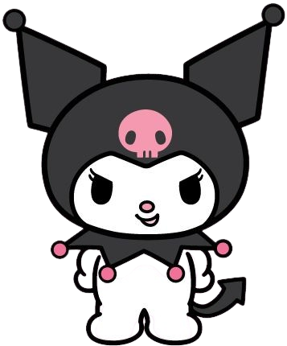

  

  

  

  

  
  

  

  

  

  

  <a href="https://github.com/Ngducok/Food-Classfication">Food Classification</a> &nbsp;·&nbsp;
  <a href="https://github.com/Ngducok/esp32s3-Super-mini-AI">ESP32-S3 AI</a> &nbsp;·&nbsp;
  <a href="https://github.com/Ngducok/Line-following-Robot">Line-following Robot</a>

  

  
  

